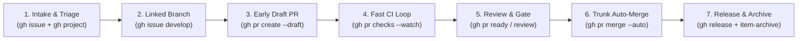

[Kiwiki Home](/../../)
[Back to Git](./readme.md)

# GitHub CLI (`gh`)

`gh` is the official GitHub command-line tool that brings pull requests, issues, GitHub Projects (`/projects`), GitHub Actions workflows, releases, and API operations directly to the terminal next to `git`.

* **Official Website:** [GitHub CLI (`cli.github.com`)](https://cli.github.com/)
* **Official Manual:** [GitHub CLI Manual](https://cli.github.com/manual/)
* **Command Reference:** [GitHub CLI Reference](https://cli.github.com/manual/gh)

---

## 1. Installation, Authentication & Configuration

### Installation

* Install `gh` on Linux (Debian/Ubuntu)

```bash
sudo apt update && sudo apt install gh -y
```

* Install `gh` on macOS (Homebrew)

```bash
brew install gh
```

* Install `gh` on Windows (Winget)

```powershell
winget install --id GitHub.cli
```

* Check installed `gh` version

```bash
gh --version
```

### Authentication (`gh auth`)

* Interactive login (browser or device code flow)

```bash
gh auth login
```

* Authenticate specifically with SSH protocol and upload public SSH key

```bash
gh auth login --git-protocol ssh --web
```

* Authenticate in CI/CD or headless environments using a Fine-Grained Personal Access Token (PAT)

```bash
export GH_TOKEN="github_pat_xxxxxxxxxxxx"
# Or pipe token via stdin:
echo "$MY_GITHUB_PAT" | gh auth login --with-token
```

* Check authentication status and active token scopes across accounts

```bash
gh auth status
```

* Switch between multiple authenticated GitHub accounts (e.g., work vs. personal)

```bash
gh auth switch --user <github-username>
```

* Configure `git` to use `gh` as the credential helper for HTTPS operations

```bash
gh auth setup-git
```

* Refresh authentication and add the `project` scope (required for `/projects` automation)

```bash
gh auth refresh -s project,read:project
```

### CLI Configuration (`gh config`)

* Set preferred terminal text editor, default git protocol, and prompt behavior

```bash
gh config set editor "code --wait"
gh config set git_protocol ssh
gh config set prompt enabled
```

* List all active `gh` configuration settings

```bash
gh config list
```

---

## 2. Repository & Ruleset Operations (`gh repo`, `gh ruleset`)

* Clone a repository using `OWNER/REPO` shorthand

```bash
gh repo clone <org-or-user>/<repo-name>
```

* Create a new private repository from the current local Git directory and push

```bash
gh repo create <org-or-user>/<repo-name> --private --source=. --remote=origin --push
```

* Create a new repository from a standardized organization template repository

```bash
gh repo create <org-or-user>/<new-repo> --template <org-or-user>/<template-repo> --private --clone
```

* Set the default remote repository for `gh` commands (crucial when working with forks or multiple remotes)

```bash
gh repo set-default <org-or-user>/<repo-name>
```

* Open the current repository, a specific file at a line number, or branch settings in the browser

```bash
gh browse
gh browse src/main.py:42
gh browse --settings
```

* Inspect active repository rulesets and verify branch protection rules on `main`

```bash
gh ruleset list
gh ruleset check main
```

---

## 3. Issues & Branch Creation (`gh issue`)

* List open issues assigned to you with specific labels

```bash
gh issue list --assignee "@me" --label "bug" --state open
```

* Search issues using GitHub search syntax

```bash
gh issue list --search "is:open label:priority:high no:assignee sort:created-asc"
```

* Create a new issue with labels, assignee, and milestone

```bash
gh issue create \
  --title "fix(auth): handle token refresh timeout" \
  --body "Steps to reproduce and acceptance criteria..." \
  --label "bug,priority:high" \
  --assignee "@me" \
  --milestone "v1.4.0"
```

* Create and check out a linked development branch directly from an issue (`gh issue develop`)

```bash
ISSUE_NUMBER=142
gh issue develop "$ISSUE_NUMBER" --checkout --name "fix/${ISSUE_NUMBER}-token-refresh-timeout"
```

* List branches linked to a specific issue

```bash
gh issue develop --list 142
```

* View issue details and comments in the terminal

```bash
gh issue view 142 --comments
```

* Close an issue with a resolution comment

```bash
gh issue close 142 --comment "Resolved via PR #145" --reason "completed"
```

---

## 4. Pull Request Lifecycle (`gh pr`)

* Check status of PRs relevant to you (current branch, created by you, awaiting your review)

```bash
gh pr status
```

* Create a Draft Pull Request early in development to trigger CI pipelines

```bash
gh pr create \
  --draft \
  --base main \
  --title "feat(api): add idempotency key validation" \
  --body "Closes #142. Work in progress—running initial CI checks." \
  --label "work-in-progress"
```

* Create a ready-for-review PR auto-populated from commit messages and request reviewers

```bash
gh pr create \
  --fill \
  --base main \
  --reviewer "<teammate-user>,<org/team-slug>" \
  --assignee "@me" \
  --label "enhancement"
```

* Promote a Draft PR to Ready for Review

```bash
gh pr ready
```

* List open Pull Requests awaiting your review

```bash
gh pr list --search "is:open review-requested:@me -is:draft"
```

* Check out any Pull Request locally by number to test or inspect

```bash
gh pr checkout 145
```

* View the diff of a Pull Request in the terminal

```bash
gh pr diff 145
```

* Watch CI status checks on the current PR in real time and exit non-zero if any check fails

```bash
gh pr checks --watch --fail-fast
```

* Review a Pull Request from the command line (approve, request changes, or comment)

```bash
gh pr review 145 --approve --body "LGTM! Verified locally and CI checks pass."
gh pr review 145 --request-changes --body "Please add error handling for empty payload."
```

* Update the PR branch with the latest changes from the base branch using rebase

```bash
gh pr update-branch --rebase
```

* Enable auto-merge with squash and automatic branch deletion once required checks and approvals pass

```bash
gh pr merge 145 --squash --delete-branch --auto
```

---

## 5. GitHub Projects (`/projects`) Module (`gh project`)

GitHub Projects (`https://github.com/orgs/<org>/projects` or `https://github.com/users/<user>/projects`) provides a flexible planning and tracking layer across repositories. The `gh project` module allows full terminal and CI/CD automation of boards, custom fields, draft issues, and item state transitions.

* **Minimum Token Scopes:** `project` (for read/write) or `read:project` (for read-only queries).

* Verify and grant the `project` token scope

```bash
gh auth status
gh auth refresh -s project
```

### Use Case 5.1: Project Board Bootstrap, Linking & Templating

Standardize project governance across teams by maintaining an organization template project and provisioning new boards from the CLI.

* List all open projects for an organization or your personal account (`@me`)

```bash
gh project list --owner <org-name>
gh project list --owner "@me"
```

* Create a new GitHub Project board

```bash
gh project create --owner <org-name> --title "Q4 Platform Engineering Delivery"
```

* View a project summary in the terminal or open it directly in the browser

```bash
PROJECT_NUM=4
gh project view "$PROJECT_NUM" --owner <org-name>
gh project view "$PROJECT_NUM" --owner <org-name> --web
```

* Link a project board to one or more repositories and teams so issues/PRs associate automatically

```bash
PROJECT_NUM=4
ORG="my-org"

gh project link "$PROJECT_NUM" --owner "$ORG" --repo "core-service"
gh project link "$PROJECT_NUM" --owner "$ORG" --repo "api-gateway"
gh project link "$PROJECT_NUM" --owner "$ORG" --team "platform-team"
```

* Mark a well-structured project board as a reusable Organization Template

```bash
gh project mark-template 1 --owner "$ORG"
```

* Copy an existing template project to bootstrap a new project (optionally including draft issues)

```bash
gh project copy 1 \
  --source-owner "$ORG" \
  --target-owner "$ORG" \
  --title "Service Migration - Phase 2" \
  --drafts
```

### Use Case 5.2: Custom Field & Schema Governance (`field-list`, `field-create`)

Enforce consistent, tech-stack-neutral metadata across all work items (Priority, Size, Risk, Target Date) without relying on ad-hoc repository labels.

* List all fields configured on a project (and export JSON to inspect GraphQL field and option IDs)

```bash
PROJECT_NUM=4
ORG="my-org"

gh project field-list "$PROJECT_NUM" --owner "$ORG"
gh project field-list "$PROJECT_NUM" --owner "$ORG" --format json
```

* Create a `SINGLE_SELECT` Priority field for triage governance

```bash
gh project field-create "$PROJECT_NUM" \
  --owner "$ORG" \
  --name "Priority" \
  --data-type "SINGLE_SELECT" \
  --single-select-options "P0-Critical,P1-High,P2-Medium,P3-Low"
```

* Create a `SINGLE_SELECT` Size / T-Shirt estimation field

```bash
gh project field-create "$PROJECT_NUM" \
  --owner "$ORG" \
  --name "Size" \
  --data-type "SINGLE_SELECT" \
  --single-select-options "XS,S,M,L,XL"
```

* Create a `NUMBER` field for Story Points or Cycle Time and a `DATE` field for Target Release Date

```bash
gh project field-create "$PROJECT_NUM" --owner "$ORG" --name "Points" --data-type "NUMBER"
gh project field-create "$PROJECT_NUM" --owner "$ORG" --name "Target Date" --data-type "DATE"
gh project field-create "$PROJECT_NUM" --owner "$ORG" --name "ADR / Spec URL" --data-type "TEXT"
```

### Use Case 5.3: Backlog Intake, Cross-Repo Tracking & Querying (`item-create`, `item-add`, `item-list`)

* Create a Draft Issue on the project board during early architecture discovery (before choosing a target repository)

```bash
gh project item-create "$PROJECT_NUM" \
  --owner "$ORG" \
  --title "Spike: Evaluate OpenTelemetry collector memory footprint" \
  --body "Define benchmark criteria before creating service-specific implementation issues."
```

* Add an existing repository Issue or Pull Request to the project board by URL

```bash
gh project item-add "$PROJECT_NUM" \
  --owner "$ORG" \
  --url "https://github.com/my-org/core-service/issues/142"
```

* List project items with custom fields (`Status`, `Priority`) displayed as extra columns

```bash
gh project item-list "$PROJECT_NUM" \
  --owner "$ORG" \
  --field "Status" \
  --field "Priority" \
  --limit 50
```

* Filter project items using GitHub Projects query syntax (e.g., open items assigned to you that are not `Done`)

```bash
gh project item-list "$PROJECT_NUM" \
  --owner "$ORG" \
  --query "assignee:@me is:open -status:Done" \
  --field "Status" \
  --field "Priority"
```

* Query high-priority bugs across all linked repositories in the project using JSON + `jq`

```bash
gh project item-list "$PROJECT_NUM" \
  --owner "$ORG" \
  --query "label:bug -status:Done" \
  --format json \
  --jq '.items[] | {id: .id, title: .title, status: .status, repo: .repository, url: .content.url}'
```

### Use Case 5.4: Automated Item State Transitions & Board Hygiene (`item-edit`, `item-archive`)

* Update an issue's or PR's `Status` or `Priority` on a project board directly by URL and field name

```bash
PROJECT_NUM=4
ORG="my-org"
ISSUE_URL="https://github.com/my-org/core-service/issues/142"

# Move item to "In Progress"
gh project item-edit "$PROJECT_NUM" \
  --owner "$ORG" \
  --url "$ISSUE_URL" \
  --field "Status" \
  --value "In Progress"

# Set item Priority to "P1-High"
gh project item-edit "$PROJECT_NUM" \
  --owner "$ORG" \
  --url "$ISSUE_URL" \
  --field "Priority" \
  --value "P1-High"
```

* Scripted/CI update using GraphQL node IDs (for setting `DATE`, `NUMBER`, `TEXT`, or `SINGLE_SELECT` option IDs)

```bash
PROJECT_NUM=4
ORG="my-org"

# 1. Resolve Project GraphQL ID
PROJECT_ID=$(gh project view "$PROJECT_NUM" --owner "$ORG" --format json --jq '.id')

# 2. Resolve Field ID for "Target Date"
FIELD_ID=$(gh project field-list "$PROJECT_NUM" --owner "$ORG" --format json \
  --jq '.fields[] | select(.name == "Target Date") | .id')

# 3. Resolve Item ID by Issue URL
ITEM_ID=$(gh project item-list "$PROJECT_NUM" --owner "$ORG" --format json \
  --jq '.items[] | select(.content.url == "https://github.com/my-org/core-service/issues/142") | .id')

# 4. Update the Date field on the project item
gh project item-edit \
  --id "$ITEM_ID" \
  --project-id "$PROJECT_ID" \
  --field-id "$FIELD_ID" \
  --date "2026-12-01"
```

* Clear a field value on a project item

```bash
gh project item-edit --id "$ITEM_ID" --project-id "$PROJECT_ID" --field-id "$FIELD_ID" --clear
```

* Archive all `Done` items from a project board at the end of a sprint or release cycle

```bash
PROJECT_NUM=4
ORG="my-org"

gh project item-list "$PROJECT_NUM" --owner "$ORG" --query "status:Done" --format json \
  --jq -r '.items[].id' | while read -r item_id; do
    echo "Archiving item: $item_id"
    gh project item-archive "$PROJECT_NUM" --owner "$ORG" --id "$item_id"
done
```

---

## 6. GitHub Actions, Workflows & Secrets (`gh workflow`, `gh run`, `gh secret`)

* List all workflows in the repository

```bash
gh workflow list
```

* Manually trigger a `workflow_dispatch` pipeline on a specific branch with input parameters

```bash
gh workflow run deploy.yml --ref main -f environment=staging -f dry_run=false
```

* List recent workflow runs for a specific branch or workflow

```bash
gh run list --branch main --limit 10
gh run list --workflow ci.yml --status failure
```

* Watch an active workflow run in real time and return its exit code (ideal for terminal bells or scripts)

```bash
gh run watch --exit-status
```

* View only the failed step logs of a broken CI run (`--log-failed`)

```bash
RUN_ID=123456789
gh run view "$RUN_ID" --log-failed
```

* Re-run only the failed jobs of a workflow run

```bash
gh run rerun "$RUN_ID" --failed
```

* Download build or test artifacts generated by a workflow run

```bash
gh run download "$RUN_ID" --name coverage-report --dir ./artifacts
```

* Manage GitHub Actions caches to clear corrupted build caches

```bash
gh cache list
gh cache delete --all
```

* Set repository or environment secrets and configuration variables from local `.env` files or stdin

```bash
gh secret set API_SIGNING_KEY --env production < ./secret.txt
gh secret set --env staging -f .env.staging
gh variable set LOG_LEVEL --body "info" --env production
```

---

## 7. Releases, Tags & Supply Chain Attestations (`gh release`, `gh attestation`)

* Create a semantic release with auto-generated release notes and tag verification

```bash
gh release create v1.4.0 \
  --title "v1.4.0" \
  --generate-notes \
  --verify-tag
```

* Create a release with custom artifacts (binaries, SBOM, checksums) attached

```bash
gh release create v1.4.0 ./dist/*.tar.gz ./dist/checksums.txt \
  --generate-notes \
  --latest
```

* Verify artifact provenance and build attestations before deployment

```bash
gh attestation verify ./dist/app-linux-amd64.tar.gz --owner <org-name>
```

---

## 8. Best Patterns for Stable SDLC Flow (Language & Stack Neutral)

Regardless of whether a repository contains Go, Python, Java, Rust, TypeScript, or Infrastructure-as-Code (Terraform/Ansible), high-performing engineering teams rely on **small batch sizes, fast feedback loops, explicit WIP limits, and automated state transitions**.

### End-to-End SDLC Flow Architecture



### Pattern 1: Issue-First Traceability & Linked Branching

**Goal:** Eliminate "invisible work" and orphan branches. Every code change maps to a well-scoped issue tracked on the `/projects` board before a branch is cut.

* Create or claim an issue, attach it to the Project board, move it to `In Progress`, and check out a linked branch in one flow

```bash
PROJECT_NUM=4
ORG="my-org"

# 1. Create the issue and capture its URL
ISSUE_URL=$(gh issue create \
  --title "feat(storage): enforce encryption at rest on state buckets" \
  --body "Acceptance Criteria:\n- [ ] Enable KMS encryption\n- [ ] Add policy validation test" \
  --label "enhancement" \
  --assignee "@me")

# 2. Register the issue on the Project board and set Status + Priority
gh project item-add "$PROJECT_NUM" --owner "$ORG" --url "$ISSUE_URL"
gh project item-edit "$PROJECT_NUM" --owner "$ORG" --url "$ISSUE_URL" --field "Status" --value "In Progress"
gh project item-edit "$PROJECT_NUM" --owner "$ORG" --url "$ISSUE_URL" --field "Priority" --value "P1-High"

# 3. Extract the issue number and create a linked branch automatically
ISSUE_NUM="${ISSUE_URL##*/}"
gh issue develop "$ISSUE_NUM" --checkout --name "feat/${ISSUE_NUM}-encrypt-state-buckets"
```

### Pattern 2: Small Batch Sizes & Early Draft Pull Requests

**Goal:** Avoid long-lived feature branches and massive " Friday afternoon" PRs. Push the first atomic commit early and open a **Draft PR** immediately so CI linters, security scanners, and build matrices validate the branch continuously while work progresses.

* Push the initial commit, open a Draft PR linked to the Project board, and watch CI checks

```bash
PROJECT_NUM=4
ORG="my-org"

git push -u origin HEAD

# Open Draft PR and capture its URL
PR_URL=$(gh pr create \
  --draft \
  --base main \
  --fill \
  --assignee "@me")

# Track the PR on the Project board as "In Progress"
gh project item-add "$PROJECT_NUM" --owner "$ORG" --url "$PR_URL"
gh project item-edit "$PROJECT_NUM" --owner "$ORG" --url "$PR_URL" --field "Status" --value "In Progress"
```

### Pattern 3: Fast Terminal CI Feedback Loop (Zero Context Switching)

**Goal:** Keep engineers in terminal flow instead of polling browser tabs. Immediately inspect failed test or linter logs and iterate locally.

* Watch current branch CI checks and automatically print failure logs if any step breaks

```bash
if ! gh pr checks --watch --fail-fast; then
  FAILED_RUN_ID=$(gh run list --branch "$(git branch --show-current)" --status failure --limit 1 --json databaseId --jq '.[0].databaseId')
  echo "--- CI Failure Logs (Run #$FAILED_RUN_ID) ---"
  gh run view "$FAILED_RUN_ID" --log-failed
fi
```

### Pattern 4: Controlling Work-in-Progress (WIP) & Daily Flow Standups

**Goal:** According to Little's Law ($\text{Lead Time} = \frac{\text{WIP}}{\text{Throughput}}$), reducing active Work-in-Progress and prioritizing code reviews over starting new work is the fastest way to stabilize delivery flow.

* Daily Morning Flow Check: Review blocked items and teammate PRs **before** starting new feature branches

```bash
PROJECT_NUM=4
ORG="my-org"

echo "=== 1. Teammate PRs Waiting on My Review ==="
gh pr list --search "is:open review-requested:@me -is:draft"

echo "=== 2. My Open PRs & CI Check Status ==="
gh pr status

echo "=== 3. My Active Project Board Items (WIP Check) ==="
gh project item-list "$PROJECT_NUM" \
  --owner "$ORG" \
  --query "assignee:@me -status:Done" \
  --field "Status" \
  --field "Priority"
```

* Detect aging Pull Requests across the repository (open for more than 3 days without merge)

```bash
CUTOFF_DATE=$(date -d "3 days ago" +%Y-%m-%d 2>/dev/null || date -v-3d +%Y-%m-%d)
gh pr list \
  --search "is:open -is:draft created:<=$CUTOFF_DATE" \
  --json number,title,author,createdAt,reviewDecision \
  --jq '.[] | "#\(.number) [\(.reviewDecision // "PENDING")] \(.title) (@\(.author.login)) - opened \(.createdAt)"'
```

### Pattern 5: Trunk Stability via Rebase, Quality Gates & Auto-Merge

**Goal:** Keep `main` green and releasable at all times. Transition the PR from Draft to Ready, sync with `main`, update the Project board to `In Review`, and arm `--auto` merge so the PR lands as soon as reviews and required checks pass.

* Transition PR to review and enable squash auto-merge

```bash
PROJECT_NUM=4
ORG="my-org"

# 1. Rebase onto latest main to prevent semantic merge drift
gh pr update-branch --rebase

# 2. Mark PR ready for human/team review and request reviewers
gh pr ready
gh pr edit --add-reviewer "<org/team-slug>"

# 3. Update Project board status to "In Review"
PR_URL=$(gh pr view --json url --jq '.url')
gh project item-edit "$PROJECT_NUM" --owner "$ORG" --url "$PR_URL" --field "Status" --value "In Review"

# 4. Arm auto-merge (merges automatically once required approvals + status checks pass)
gh pr merge --squash --delete-branch --auto
```

### Pattern 6: Reusable `gh alias` Kit for Standardized Team Flow

Codify these patterns into `gh alias` shortcuts so every engineer on the team can execute the exact same SDLC workflow regardless of tech stack.

* Register SDLC flow aliases in `gh`

```bash
# Alias: `gh wip` -> Show PR status and PRs awaiting your review
gh alias set wip --shell 'gh pr list --search "is:open review-requested:@me -is:draft" && gh pr status'

# Alias: `gh start <issue-number> <slug>` -> Create linked branch from issue
gh alias set start --shell 'gh issue develop "$1" --checkout --name "feat/$1-$2"'

# Alias: `gh ship` -> Rebase current PR branch, mark ready, and queue squash auto-merge
gh alias set ship --shell 'gh pr update-branch --rebase && gh pr ready && gh pr merge --squash --delete-branch --auto'

# Alias: `gh ci-logs` -> Print failed logs of the latest run on the current branch
gh alias set ci-logs --shell 'gh run view $(gh run list --branch "$(git branch --show-current)" --limit 1 --json databaseId --jq ".[0].databaseId") --log-failed'
```

* List all configured `gh` aliases

```bash
gh alias list
```

---

## 9. Advanced API & Scripting (`gh api`, `--json`, `--jq`)

When a built-in subcommand does not expose a specific field, `gh` provides structured JSON output and direct authenticated access to GitHub REST and GraphQL APIs.

* Inspect available JSON fields for any `gh` command (pass `--json` with no arguments)

```bash
gh pr list --json
gh issue view 142 --json
```

* Export structured JSON filtered with built-in `--jq` (no external `jq` binary required)

```bash
gh pr list --state merged --limit 20 --json number,title,mergedAt,author \
  --jq '.[] | "\(.mergedAt[0:10]) | #\(.number) | \(.title) (@\(.author.login))"'
```

* Query GitHub REST API with automatic pagination (`--paginate`)

```bash
gh api repos/{owner}/{repo}/contributors --paginate --jq '.[].login'
```

* Execute a custom GraphQL query via `gh api graphql`

```bash
gh api graphql -f query='
  query($owner: String!, $repo: String!) {
    repository(owner: $owner, name: $repo) {
      nameWithOwner
      defaultBranchRef { name }
      openIssues: issues(states: OPEN) { totalCount }
      openPRs: pullRequests(states: OPEN) { totalCount }
    }
  }
' -F owner="{owner}" -F repo="{repo}"
```

---

## References

1. [GitHub CLI Official Site](https://cli.github.com/)
2. [GitHub CLI Manual & Command Reference](https://cli.github.com/manual/)
3. [GitHub CLI `gh project` Manual](https://cli.github.com/manual/gh_project)
4. [GitHub Docs: Planning and tracking with Projects](https://docs.github.com/en/issues/planning-and-tracking-with-projects)
5. [GitHub Docs: Using GitHub CLI in GitHub Actions Workflows](https://docs.github.com/en/actions/using-workflows/using-github-cli-in-workflows)

[Back to top](#)
[Back to Git](./readme.md)
[Kiwiki Home](/../../)
