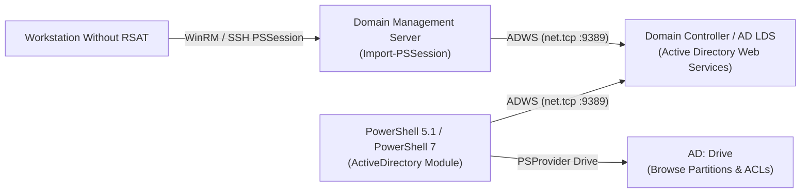

# PowerShell Active Directory Module (`ActiveDirectory`)

The `ActiveDirectory` module is Microsoft's official PowerShell module for administering **Active Directory Domain Services (AD DS)** and **Active Directory Lightweight Directory Services (AD LDS)** from the command line. It provides cmdlets for managing users, groups, computers, Organizational Units (OUs), Fine-Grained Password Policies, replication health, deleted object recovery, and domain/forest topology, and it also exposes the `AD:` PowerShell provider drive for browsing directory partitions like a filesystem.

* **Official Module Reference:** [ActiveDirectory Module (Microsoft Learn)](https://learn.microsoft.com/en-us/powershell/module/activedirectory/)
* **Conceptual Overview:** [about_ActiveDirectory](https://learn.microsoft.com/en-us/powershell/module/activedirectory/about/about_activedirectory)
* **Filter Expression Guide:** [about_ActiveDirectory_Filter](https://learn.microsoft.com/en-us/powershell/module/activedirectory/about/about_activedirectory_filter)
* **Standalone LDAP Queries:** [LDAP Queries & Directory Tools](../../../ldap/readme.md)

> **PowerShell 7 vs. Windows PowerShell 5.1:** On Windows 10 (1809+), Windows 11, and Windows Server 2019+, the RSAT `ActiveDirectory` module supports **PowerShell 7 (`Core`) natively** in addition to Windows PowerShell 5.1 (`Desktop`). On older builds where only the `Desktop` edition is registered, load it via Windows PowerShell compatibility (`Import-Module -Name "ActiveDirectory" -UseWindowsPowerShell`) or import it over PowerShell Remoting from a domain-joined management server.

> **ADWS Transport & Query Safety:** Unlike raw LDAP tools (TCP `389`/`636`), the `ActiveDirectory` PowerShell module communicates exclusively with **Active Directory Web Services (ADWS)** over **TCP port `9389`** on Domain Controllers. Always "filter left" using `-Filter` or `-LDAPFilter` instead of piping `-Filter *` into `Where-Object`, request only the `-Properties` you need, and test destructive changes with `-WhatIf` first.



---

## 1. Installation, Compatibility & Session Setup

The `ActiveDirectory` module is part of **Remote Server Administration Tools (RSAT)**. It is pre-installed on Domain Controllers and available as a Feature on Demand on Windows clients (Pro, Enterprise, and Education editions) or as a Windows Feature on Windows Server.

### Installing RSAT (`Windows 10/11` & `Windows Server`)

* List available RSAT capabilities and their installation state on Windows 10 or Windows 11 (run as Administrator)

```powershell
Get-WindowsCapability -Name "RSAT*" -Online | Select-Object -Property DisplayName, Name, State | Format-Table -AutoSize
```

* Install the Active Directory DS/LDS tools and PowerShell module on Windows 10 (1809+) or Windows 11

```powershell
Add-WindowsCapability -Online -Name "Rsat.ActiveDirectory.DS-LDS.Tools~~~~0.0.1.0"
```

* Install only the Active Directory PowerShell module on Windows Server (without full GUI snap-ins)

```powershell
Install-WindowsFeature -Name "RSAT-AD-PowerShell"
```

* Install full AD management tools (ADUC, ADAC, and PowerShell module) on Windows Server

```powershell
Install-WindowsFeature -Name "RSAT-AD-Tools" -IncludeAllSubFeature
```

### Importing, Compatibility & Remote Sessions

* Verify the installed `ActiveDirectory` module version and compatible PowerShell editions

```powershell
Get-Module -ListAvailable -Name "ActiveDirectory" | Select-Object -Property Name, Version, CompatiblePSEditions, Path
```

* Import the module explicitly and list all exported cmdlets grouped by noun

```powershell
Import-Module -Name "ActiveDirectory"
Get-Command -Module "ActiveDirectory" | Sort-Object -Property Noun, Verb | Format-Table -Property Name, CommandType -AutoSize
```

* Load `ActiveDirectory` via Windows PowerShell compatibility mode when running PowerShell 7 on older Windows builds

```powershell
Import-Module -Name "ActiveDirectory" -UseWindowsPowerShell
```

* Import the `ActiveDirectory` module remotely from a management jump host when working on a non-RSAT workstation (implicit remoting)

```powershell
$Session = New-PSSession -ComputerName "mgmt01.corp.contoso.com"
Invoke-Command -Session $Session -ScriptBlock { Import-Module -Name "ActiveDirectory" }
Import-PSSession -Session $Session -Module "ActiveDirectory" -Prefix "Remote"
```

### Session Defaults & the `AD:` PowerShell Drive

* Pin a specific Domain Controller and alternate admin credential for all AD cmdlets in the current session using `$PSDefaultParameterValues`

```powershell
$AdminCred = Get-Credential -UserName "corp\adm_jdoe" -Message "Enter Active Directory admin credentials"

$PSDefaultParameterValues["*-AD*:Server"]     = "dc01.corp.contoso.com"
$PSDefaultParameterValues["*-AD*:Credential"] = $AdminCred
```

* Clear session-level AD defaults when finished

```powershell
$PSDefaultParameterValues.Remove("*-AD*:Server")
$PSDefaultParameterValues.Remove("*-AD*:Credential")
```

* Mount an additional `AD:` PSDrive for another domain/forest or inspect directory objects and ACLs through the built-in `AD:` provider

```powershell
Get-PSDrive -Name "AD"
Set-Location -Path "AD:\DC=corp,DC=contoso,DC=com"
Get-ChildItem | Select-Object -Property Name, ObjectClass, DistinguishedName
```

* Inspect delegated Active Directory permissions (ACLs) on an Organizational Unit via the `AD:` drive

```powershell
(Get-Acl -Path "AD:\OU=Workstations,DC=corp,DC=contoso,DC=com").Access |
    Select-Object -Property IdentityReference, ActiveDirectoryRights, AccessControlType, IsInherited |
    Format-Table -AutoSize
```

---

## 2. Querying & Filtering Best Practices (`-Filter`, `-LDAPFilter`, `-Properties`)

Every AD query should push filtering logic to the Domain Controller (**filter left**) and request only the extended attributes needed for the task.

> **String `-Filter` Quoting & Date Gotchas:** Prefer **single-quoted** filter strings (`'Enabled -eq $true'`) when passing boolean values (`$true`/`$false`) or `[datetime]` variables, because the Active Directory expression parser resolves PowerShell variables directly in their native types without locale formatting errors. Use **double-quoted** strings (`"Department -eq '$Dept'"`) when interpolating string properties (such as `$Row.Department`), and avoid `{ ... }` script blocks for complex expressions since script-block `.ToString()` serialization cannot evaluate object properties like `$User.Name`.

> **`lastLogon` vs. `lastLogonTimestamp` / `LastLogonDate`:** The `lastLogon` attribute is **not replicated** between Domain Controllers and is exact only on the DC that authenticated the user. By contrast, `lastLogonTimestamp` (exposed as a converted `DateTime` in PowerShell's `LastLogonDate` property) **is replicated**, with an intentional sync lag of roughly 9–14 days (`msDS-LogonTimeSyncInterval`).

* Retrieve a single user's default 10 attributes by `SamAccountName`, `DistinguishedName`, `ObjectGUID`, or `SID`

```powershell
Get-ADUser -Identity "jdoe"
```

* Query users using server-side `-Filter` while requesting only specific extended attributes (faster and lighter than `-Properties *`)

```powershell
$TargetDepartment = "Engineering"

Get-ADUser `
    -Filter "Department -eq '$TargetDepartment' -and Enabled -eq `$true" `
    -Properties "Department", "Title", "Mail", "Manager", "LastLogonDate" |
    Select-Object -Property SamAccountName, Name, Title, Mail, LastLogonDate |
    Format-Table -AutoSize
```

* Query accounts created within the last 30 days using a `[datetime]` variable in a single-quoted `-Filter` (locale-safe)

```powershell
$CutoffDate = (Get-Date).AddDays(-30)

Get-ADUser -Filter 'whenCreated -ge $CutoffDate' -Properties "whenCreated", "Department" |
    Select-Object -Property SamAccountName, Department, whenCreated |
    Sort-Object -Property whenCreated -Descending
```

* Scope a query to a specific OU (`-SearchBase`) and depth (`Base`, `OneLevel`, `Subtree`), lifting result caps with `-ResultSetSize $null`

```powershell
Get-ADUser `
    -Filter * `
    -SearchBase "OU=Users,OU=Wellington,DC=corp,DC=contoso,DC=com" `
    -SearchScope "Subtree" `
    -ResultSetSize $null `
    -ResultPageSize 500 `
    -Properties "Mail", "Enabled" |
    Select-Object -Property SamAccountName, Mail, Enabled
```

* Use `-LDAPFilter` with Ambiguous Name Resolution (`anr=`) to match across display name, `sAMAccountName`, `mail`, and surname in one call

```powershell
Get-ADObject -LDAPFilter "(anr=Jane Doe)" -Properties "ObjectClass", "Mail", "Department"
```

* Use `-LDAPFilter` bitwise matching (`1.2.840.113556.1.4.803`) to find accounts with `PasswordNeverExpires` (`userAccountControl` bit `65536`)

```powershell
Get-ADUser -LDAPFilter "(&(objectCategory=person)(objectClass=user)(userAccountControl:1.2.840.113556.1.4.803:=65536))" -Properties "PasswordLastSet" |
    Select-Object -Property SamAccountName, Enabled, PasswordLastSet
```

---

## 3. User Account Lifecycle (`Get-ADUser`, `New-ADUser`, `Set-ADUser`, `Remove-ADUser`)

### Inspecting & Creating Users

* Inspect all populated attributes on a specific user account (useful during schema or attribute troubleshooting)

```powershell
Get-ADUser -Identity "jdoe" -Properties *
```

* Create a new user account with splatting, an encrypted `SecureString` password, and `-WhatIf` preview before committing

```powershell
$InitialPassword = Read-Host -Prompt "Enter temporary password for new user" -AsSecureString

$NewUserParams = @{
    Name                  = "Jane Doe"
    GivenName             = "Jane"
    Surname               = "Doe"
    DisplayName           = "Jane Doe"
    SamAccountName        = "jdoe"
    UserPrincipalName     = "jdoe@corp.contoso.com"
    EmailAddress          = "jane.doe@contoso.com"
    Department            = "Platform Engineering"
    Title                 = "Senior SRE"
    Path                  = "OU=Users,OU=Wellington,DC=corp,DC=contoso,DC=com"
    AccountPassword       = $InitialPassword
    ChangePasswordAtLogon = $true
    Enabled               = $true
    PassThru              = $true
}

# Remove -WhatIf once verified
New-ADUser @NewUserParams -WhatIf
```

### Updating Attributes, Passwords & Account State

* Update standard properties and manager relationship on an existing user

```powershell
Set-ADUser `
    -Identity "jdoe" `
    -Title "Principal SRE" `
    -Department "Cloud Infrastructure" `
    -Manager "asmith" `
    -Description "Updated via automation - Ticket INC-4821"
```

* Add, replace, or clear extended/custom attributes (such as `extensionAttribute1` or `proxyAddresses`) using hashtable operators

```powershell
# Add a secondary SMTP alias without overwriting existing proxyAddresses
Set-ADUser -Identity "jdoe" -Add @{ proxyAddresses = "smtp:jane.d@contoso.com" }

# Replace a custom attribute value
Set-ADUser -Identity "jdoe" -Replace @{ extensionAttribute1 = "CostCenter-4410" }

# Clear an attribute completely
Set-ADUser -Identity "jdoe" -Clear "extensionAttribute2"
```

* Reset a forgotten user password (`-Reset` is required when not supplying `-OldPassword`) and force change at next logon

```powershell
$NewPassword = Read-Host -Prompt "Enter new temporary password" -AsSecureString

Set-ADAccountPassword -Identity "jdoe" -Reset -NewPassword $NewPassword
Set-ADUser -Identity "jdoe" -ChangePasswordAtLogon $true
```

* Unlock a locked-out user account, toggle enabled state, or configure an account expiration date

```powershell
Unlock-ADAccount -Identity "jdoe"
Enable-ADAccount -Identity "jdoe"
Disable-ADAccount -Identity "jdoe" -WhatIf
Set-ADAccountExpiration -Identity "contractor_01" -DateTime "2027-03-31 17:00:00"
```

### Moving & Deleting Users

* Move a user account to another Organizational Unit (`Move-ADObject`)

```powershell
Get-ADUser -Identity "jdoe" | Move-ADObject -TargetPath "OU=Disabled Users,DC=corp,DC=contoso,DC=com" -WhatIf
```

* Delete a user account safely (always preview with `-WhatIf` first; note that accidental-deletion protection blocks removal unless cleared)

```powershell
Remove-ADUser -Identity "jdoe" -WhatIf
```

---

## 4. Security & Distribution Groups (`*-ADGroup*`)

### Querying & Creating Groups

* List all Domain Local, Global, or Universal security groups matching a naming prefix

```powershell
Get-ADGroup -Filter "GroupCategory -eq 'Security' -and Name -like 'App_*'" -Properties "Description", "ManagedBy" |
    Select-Object -Property Name, GroupScope, ManagedBy, Description |
    Format-Table -AutoSize
```

* Create a new security group in a target OU with a designated owner (`-ManagedBy`)

```powershell
New-ADGroup `
    -Name "SG_GitHub_Enterprise_Admins" `
    -SamAccountName "SG_GitHub_Enterprise_Admins" `
    -GroupCategory "Security" `
    -GroupScope "Global" `
    -Path "OU=Security Groups,DC=corp,DC=contoso,DC=com" `
    -ManagedBy "asmith" `
    -Description "Grants administrative access to GitHub Enterprise"
```

### Membership Inspection & Nested Groups

* List direct members of a group or expand nested memberships recursively

```powershell
Get-ADGroupMember -Identity "SG_Platform_Engineers" | Select-Object -Property Name, SamAccountName, objectClass
Get-ADGroupMember -Identity "SG_Platform_Engineers" -Recursive | Select-Object -Property Name, SamAccountName | Sort-Object -Property SamAccountName
```

* List all groups a user belongs to directly (`Get-ADPrincipalGroupMembership`)

```powershell
Get-ADPrincipalGroupMembership -Identity "jdoe" | Select-Object -Property Name, GroupCategory, GroupScope | Sort-Object -Property Name
```

* Find all users with **nested** membership in a group using LDAP matching-rule-in-chain (`1.2.840.113556.1.4.1941`) — avoids the ADWS 5,000-member cap and Foreign Security Principal errors in `Get-ADGroupMember -Recursive`

```powershell
$GroupDN = (Get-ADGroup -Identity "SG_Platform_Engineers").DistinguishedName

Get-ADUser -LDAPFilter "(memberOf:1.2.840.113556.1.4.1941:=$GroupDN)" -Properties "Mail", "Enabled" |
    Select-Object -Property SamAccountName, Name, Mail, Enabled |
    Format-Table -AutoSize
```

### Modifying & Cloning Group Memberships

* Add or remove one or more members from a group (always test bulk removals with `-WhatIf`)

```powershell
Add-ADGroupMember -Identity "SG_Platform_Engineers" -Members "jdoe", "msmith"
Remove-ADGroupMember -Identity "SG_Platform_Engineers" -Members "jdoe" -Confirm:$false -WhatIf
```

* Copy all non-primary group memberships from an existing reference user to a new starter

```powershell
$TemplateUser = "asmith"
$NewUser      = "jdoe"

Get-ADPrincipalGroupMembership -Identity $TemplateUser |
    Where-Object -FilterScript { $_.SamAccountName -ne "Domain Users" } |
    ForEach-Object -Process {
        Add-ADGroupMember -Identity $_.DistinguishedName -Members $NewUser -WhatIf
    }
```

---

## 5. Computers & Organizational Units (`*-ADComputer`, `*-ADOrganizationalUnit`)

### Computer Lifecycle & Stale Workstation Detection

* Inventory domain-joined computers grouped by Operating System

```powershell
Get-ADComputer -Filter "Enabled -eq `$true" -Properties "OperatingSystem", "OperatingSystemVersion" |
    Group-Object -Property OperatingSystem -NoElement |
    Sort-Object -Property Count -Descending |
    Format-Table -AutoSize
```

* Find stale computer accounts whose machine password has not rotated in over 90 days (computer passwords rotate automatically every 30 days on healthy domain-joined hosts)

```powershell
$CutoffDate = (Get-Date).AddDays(-90)

Get-ADComputer `
    -Filter 'Enabled -eq $true -and PasswordLastSet -lt $CutoffDate' `
    -Properties "OperatingSystem", "PasswordLastSet", "LastLogonDate", "Description" |
    Select-Object -Property Name, OperatingSystem, PasswordLastSet, LastLogonDate |
    Sort-Object -Property PasswordLastSet |
    Format-Table -AutoSize
```

* Disable stale computer accounts and move them to a staging OU before future deletion

```powershell
$StaleComputersOU = "OU=Stale Computers,DC=corp,DC=contoso,DC=com"

Get-ADComputer -Identity "OLD-LAPTOP-09" |
    Set-ADComputer -Enabled $false -Description "Disabled due to >90d inactivity - $(Get-Date -Format 'yyyy-MM-dd')" -PassThru |
    Move-ADObject -TargetPath $StaleComputersOU -WhatIf
```

### Organizational Units & GPO Links

* List all Organizational Units and check accidental-deletion protection and linked GPOs

```powershell
Get-ADOrganizationalUnit -Filter * -Properties "ProtectedFromAccidentalDeletion", "LinkedGroupPolicyObjects" |
    Select-Object -Property Name, DistinguishedName, ProtectedFromAccidentalDeletion |
    Format-Table -AutoSize
```

* Create a new Organizational Unit with accidental-deletion protection explicitly enabled

```powershell
New-ADOrganizationalUnit `
    -Name "Service Accounts" `
    -Path "DC=corp,DC=contoso,DC=com" `
    -Description "Dedicated OU for gMSA and service accounts" `
    -ProtectedFromAccidentalDeletion $true
```

---

## 6. Security Auditing, Lockouts & Password Policies (`Search-ADAccount`)

`Search-ADAccount` is optimized for security compliance and helpdesk diagnostics across user, computer, and service accounts.

* List all currently locked-out user accounts

```powershell
Search-ADAccount -LockedOut -UsersOnly |
    Select-Object -Property SamAccountName, Name, LockedOut, LastLogonDate, DistinguishedName |
    Format-Table -AutoSize
```

* Find disabled accounts, expired accounts, or accounts with passwords expiring soon or set never to expire

```powershell
Search-ADAccount -AccountDisabled -UsersOnly | Select-Object -Property SamAccountName, Name, LastLogonDate
Search-ADAccount -AccountExpired -UsersOnly | Select-Object -Property SamAccountName, AccountExpirationDate
Search-ADAccount -PasswordExpired -UsersOnly | Select-Object -Property SamAccountName, PasswordLastSet
Search-ADAccount -PasswordNeverExpires -UsersOnly | Where-Object -FilterScript { $_.Enabled } | Select-Object -Property SamAccountName, Name
```

* Find enabled user accounts that have been inactive for 90+ days and export an audit CSV report

```powershell
Search-ADAccount -AccountInactive -TimeSpan (New-TimeSpan -Days 90) -UsersOnly |
    Where-Object -FilterScript { $_.Enabled } |
    Select-Object -Property SamAccountName, Name, UserPrincipalName, LastLogonDate, DistinguishedName |
    Export-Csv -Path ".\stale-enabled-users-90d.csv" -NoTypeInformation -Encoding utf8
```

* Audit members of high-privilege administrative groups (`Domain Admins`, `Enterprise Admins`, `Schema Admins`, `Administrators`)

```powershell
$PrivilegedGroups = @("Domain Admins", "Enterprise Admins", "Schema Admins", "Administrators")

$PrivilegedGroups | ForEach-Object -Process {
    $GroupName = $_
    Get-ADGroupMember -Identity $GroupName -Recursive |
        Select-Object -Property @{ Name = "PrivilegedGroup"; Expression = { $GroupName } }, SamAccountName, Name, objectClass
} | Format-Table -AutoSize
```

* Inspect the Default Domain Password Policy, Fine-Grained Password Policies (PSOs), and a specific user's effective policy

```powershell
Get-ADDefaultDomainPasswordPolicy
Get-ADFineGrainedPasswordPolicy -Filter * | Select-Object -Property Name, Precedence, MinPasswordLength, LockoutThreshold, MaxPasswordAge
Get-ADUserResultantPasswordPolicy -Identity "jdoe"
```

---

## 7. Object Recovery & AD Recycle Bin (`Get-ADObject`, `Restore-ADObject`)

When the **Active Directory Recycle Bin** optional feature is enabled at the forest level, deleted objects retain all link-valued and non-link-valued attributes (including group memberships) for the tombstone/deleted-object lifetime, allowing full restoration without authoritative SYSVOL/NTDS restore.

> **Irreversible Forest Change:** Enabling the Active Directory Recycle Bin requires a minimum Forest Functional Level of Windows Server 2008 R2 and **cannot be disabled** once enabled. Always verify your forest functional level and run with `-WhatIf` first.

* Check whether the Active Directory Recycle Bin optional feature is currently enabled

```powershell
Get-ADOptionalFeature -Filter "Name -eq 'Recycle Bin Feature'" |
    Select-Object -Property Name, FeatureScope, RequiredForestMode, EnabledScopes
```

* Enable the Active Directory Recycle Bin for the forest (preview with `-WhatIf` first)

```powershell
$ForestName = (Get-ADForest).Name

Enable-ADOptionalFeature `
    -Identity "Recycle Bin Feature" `
    -Scope "ForestOrConfigurationSet" `
    -Target $ForestName `
    -WhatIf
```

* Search the `Deleted Objects` container for recently deleted users, groups, or OUs

```powershell
Get-ADObject -Filter 'Deleted -eq $true -and ObjectClass -eq "user"' -IncludeDeletedObjects -Properties "sAMAccountName", "LastKnownParent", "whenChanged" |
    Select-Object -Property Name, sAMAccountName, ObjectGUID, LastKnownParent, whenChanged |
    Sort-Object -Property whenChanged -Descending |
    Format-Table -AutoSize
```

* Restore a deleted user account (or restore a deleted parent OU first before restoring child objects)

```powershell
Get-ADObject -Filter 'sAMAccountName -eq "jdoe" -and Deleted -eq $true' -IncludeDeletedObjects |
    Restore-ADObject -WhatIf
```

* Restore a deleted object into a different OU with a new name using its `ObjectGUID`

```powershell
Restore-ADObject `
    -Identity "613dc90a-2afd-49fb-8bd8-eac48c6ab59f" `
    -NewName "Jane Doe" `
    -TargetPath "OU=Users,OU=Wellington,DC=corp,DC=contoso,DC=com" `
    -WhatIf
```

---

## 8. Domain, Forest & Replication Health (`Get-ADDomain`, `Get-ADForest`, `Get-ADReplication*`)

### Domain, Forest & FSMO Role Discovery

* Inspect current domain details, functional level, and domain-level FSMO role holders (`PDCEmulator`, `RIDMaster`, `InfrastructureMaster`)

```powershell
Get-ADDomain | Select-Object -Property DNSRoot, NetBIOSName, DomainMode, PDCEmulator, RIDMaster, InfrastructureMaster
```

* Inspect forest functional level, UPN suffixes, sites, and forest-level FSMO role holders (`SchemaMaster`, `DomainNamingMaster`)

```powershell
Get-ADForest | Select-Object -Property Name, ForestMode, SchemaMaster, DomainNamingMaster, GlobalCatalogs, Sites
```

* List all Domain Controllers in the domain with site, IP address, OS, Global Catalog, and Read-Only (RODC) status

```powershell
Get-ADDomainController -Filter * |
    Select-Object -Property HostName, Site, IPv4Address, OperatingSystem, IsGlobalCatalog, IsReadOnly, OperationMasterRoles |
    Format-Table -AutoSize
```

### Replication Diagnostics & Accurate `lastLogon`

* Inspect replication partner metadata across all Domain Controllers in the domain (check last sync success and consecutive failure counts)

```powershell
Get-ADReplicationPartnerMetadata -Target * -Scope "Domain" |
    Select-Object -Property Server, Partner, LastReplicationAttempt, LastReplicationSuccess, ConsecutiveReplicationFailures, LastReplicationResult |
    Format-Table -AutoSize
```

* Check for active replication failures across a domain or specific Domain Controller

```powershell
Get-ADReplicationFailure -Target "corp.contoso.com" -Scope "Domain" |
    Select-Object -Property Server, Partner, FailureCount, FailureType, FirstFailureTime, LastError |
    Format-Table -AutoSize
```

* Inspect pending replication operations queued on a Domain Controller

```powershell
Get-ADReplicationQueueOperation -Server "dc01.corp.contoso.com"
```

* Force immediate single-object replication between two Domain Controllers (e.g., after an urgent password reset or group change)

```powershell
$UserDN = (Get-ADUser -Identity "jdoe").DistinguishedName
Sync-ADObject -Object $UserDN -Source "dc01.corp.contoso.com" -Destination "dc02.corp.contoso.com"
```

* Query the exact (non-replicated) `lastLogon` timestamp for a user across every writable Domain Controller

```powershell
$TargetUser = "jdoe"

$DomainControllers = Get-ADDomainController -Filter "IsReadOnly -eq `$false" | Select-Object -ExpandProperty HostName

$LogonTimestamps = foreach ($DC in $DomainControllers) {
    $UserOnDC = Get-ADUser -Identity $TargetUser -Server $DC -Properties "lastLogon"
    [PSCustomObject]@{
        DomainController = $DC
        SamAccountName   = $UserOnDC.SamAccountName
        ExactLastLogon   = if ($UserOnDC.lastLogon) { [datetime]::FromFileTime($UserOnDC.lastLogon) } else { $null }
    }
}

$LogonTimestamps | Sort-Object -Property ExactLastLogon -Descending | Format-Table -AutoSize
```

---

## 9. Enterprise Automation Patterns

### Bulk CSV User Provisioning with `SecretManagement` & `-WhatIf`

Combining `ActiveDirectory` with [`Microsoft.PowerShell.SecretManagement`](./secret-management.md) keeps default onboarding passwords or privileged bind credentials out of scripts and CSV files.

* Provision users from a CSV file using a vault-stored initial password and `-WhatIf` safety toggle

```powershell
Import-Module -Name "ActiveDirectory"
Import-Module -Name "Microsoft.PowerShell.SecretManagement"

$CsvPath         = ".\new-hires.csv"
$DefaultPassword = Get-Secret -Name "AD_NewHire_TempPassword" -Vault "LocalStore"
$PreviewOnly     = $true

Import-Csv -Path $CsvPath | ForEach-Object -Process {
    $Row = $_

    if (Get-ADUser -Filter "SamAccountName -eq '$($Row.SamAccountName)'" -ErrorAction SilentlyContinue) {
        Write-Warning -Message "Skipping $($Row.SamAccountName): account already exists."
        return
    }

    $UserSplat = @{
        Name                  = "$($Row.FirstName) $($Row.LastName)"
        GivenName             = $Row.FirstName
        Surname               = $Row.LastName
        DisplayName           = "$($Row.FirstName) $($Row.LastName)"
        SamAccountName        = $Row.SamAccountName
        UserPrincipalName     = "$($Row.SamAccountName)@corp.contoso.com"
        EmailAddress          = $Row.Email
        Department            = $Row.Department
        Title                 = $Row.Title
        Path                  = $Row.TargetOU
        AccountPassword       = $DefaultPassword
        ChangePasswordAtLogon = $true
        Enabled               = $true
        WhatIf                = $PreviewOnly
    }

    New-ADUser @UserSplat
}
```

### Controlled User Offboarding Workflow

* Disable a departing user account, record the offboarding ticket, strip non-primary group memberships, rotate password, and move to a disabled OU

```powershell
function Invoke-ADUserOffboarding {
    [CmdletBinding(SupportsShouldProcess = $true, ConfirmImpact = "High")]
    param(
        [Parameter(Mandatory)]
        [string]$SamAccountName,

        [Parameter(Mandatory)]
        [string]$TicketId,

        [Parameter(Mandatory)]
        [string]$DisabledOUPath
    )

    $User = Get-ADUser -Identity $SamAccountName -Properties "MemberOf", "Description"

    if ($PSCmdlet.ShouldProcess($User.DistinguishedName, "Offboard AD user ($TicketId)")) {
        # 1. Disable account and stamp audit description
        Set-ADUser -Identity $User.DistinguishedName -Enabled $false -Manager $null -Description "Offboarded $(Get-Date -Format 'yyyy-MM-dd') - $TicketId"

        # 2. Scramble password with a random 32-byte cryptographically generated value
        $RandomBytes = [byte[]]::new(32)
        [System.Security.Cryptography.RandomNumberGenerator]::Fill($RandomBytes)
        $ScrambledPassword = ConvertTo-SecureString -String ([Convert]::ToBase64String($RandomBytes)) -AsPlainText -Force
        Set-ADAccountPassword -Identity $User.DistinguishedName -Reset -NewPassword $ScrambledPassword

        # 3. Remove all non-primary group memberships
        Get-ADPrincipalGroupMembership -Identity $User.DistinguishedName |
            Where-Object -FilterScript { $_.SamAccountName -ne "Domain Users" } |
            ForEach-Object -Process {
                Remove-ADGroupMember -Identity $_.DistinguishedName -Members $User.DistinguishedName -Confirm:$false
            }

        # 4. Move to Disabled Users OU
        Move-ADObject -Identity $User.DistinguishedName -TargetPath $DisabledOUPath
    }
}

# Preview offboarding actions without making changes
Invoke-ADUserOffboarding `
    -SamAccountName "jdoe" `
    -TicketId "HR-9042" `
    -DisabledOUPath "OU=Disabled Users,DC=corp,DC=contoso,DC=com" `
    -WhatIf
```

---

## References

1. [ActiveDirectory Module Reference (Microsoft Learn)](https://learn.microsoft.com/en-us/powershell/module/activedirectory/)
2. [about_ActiveDirectory Conceptual Help](https://learn.microsoft.com/en-us/powershell/module/activedirectory/about/about_activedirectory)
3. [about_ActiveDirectory_Filter Conceptual Help](https://learn.microsoft.com/en-us/powershell/module/activedirectory/about/about_activedirectory_filter)
4. [Remote Server Administration Tools (RSAT) for Windows](https://learn.microsoft.com/en-us/windows-server/remote/remote-server-administration-tools)
5. [Active Directory Web Services (ADWS) Overview](https://learn.microsoft.com/en-us/windows-server/identity/ad-ds/get-started/adac/active-directory-administrative-center)
6. [Get-ADUser Cmdlet Reference](https://learn.microsoft.com/en-us/powershell/module/activedirectory/get-aduser)
7. [Search-ADAccount Cmdlet Reference](https://learn.microsoft.com/en-us/powershell/module/activedirectory/search-adaccount)
8. [Get-ADGroupMember Cmdlet Reference](https://learn.microsoft.com/en-us/powershell/module/activedirectory/get-adgroupmember)
9. [Restore-ADObject & AD Recycle Bin Reference](https://learn.microsoft.com/en-us/powershell/module/activedirectory/restore-adobject)
10. [Enable-ADOptionalFeature Cmdlet Reference](https://learn.microsoft.com/en-us/powershell/module/activedirectory/enable-adoptionalfeature)
11. [Get-ADReplicationPartnerMetadata Cmdlet Reference](https://learn.microsoft.com/en-us/powershell/module/activedirectory/get-adreplicationpartnermetadata)
12. [Get-ADReplicationFailure Cmdlet Reference](https://learn.microsoft.com/en-us/powershell/module/activedirectory/get-adreplicationfailure)
