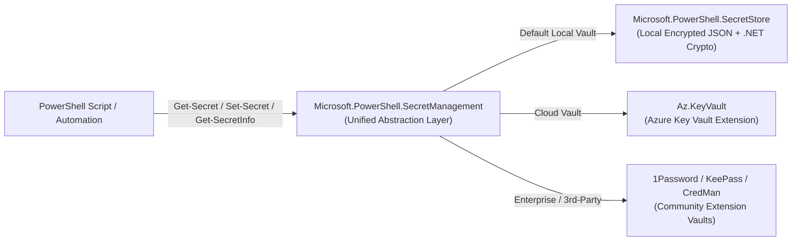

# PowerShell SecretManagement (`Microsoft.PowerShell.SecretManagement`)

`Microsoft.PowerShell.SecretManagement` provides a unified, extensible abstraction layer for storing, retrieving, and managing secrets (passwords, API keys, tokens, credentials, and binary certificates) in PowerShell without hardcoding sensitive values in scripts or configuration files.

Rather than implementing a vault storage engine itself, `SecretManagement` exposes a consistent set of cmdlets that route operations to registered **extension vaults**—such as `Microsoft.PowerShell.SecretStore` (local encrypted storage), `Az.KeyVault` (Azure Key Vault), `SecretManagement.1Password`, `SecretManagement.KeePass`, or `SecretManagement.Chromium` / Windows Credential Manager.

* **Official Module Reference:** [Microsoft.PowerShell.SecretManagement](https://learn.microsoft.com/en-us/powershell/module/microsoft.powershell.secretmanagement/?view=ps-modules)
* **Overview & Architecture:** [Overview of the SecretManagement and SecretStore modules](https://learn.microsoft.com/en-us/powershell/scripting/security/secret-management/overview-secret-management)
* **Local Extension Vault:** [Microsoft.PowerShell.SecretStore](https://learn.microsoft.com/en-us/powershell/module/microsoft.powershell.secretstore/?view=ps-modules)

> **Support Status:** Microsoft has designated `Microsoft.PowerShell.SecretManagement` and `Microsoft.PowerShell.SecretStore` as **feature-complete**. Both modules remain supported for security updates and critical bug fixes, while new cloud-native architectures increasingly favor Managed Identities, federated workload identities, and passwordless Entra ID flows.

> **User Context Isolation:** Vault registrations are stored per OS user profile (`$env:LOCALAPPDATA\Microsoft\PowerShell\secretmanagement\secretvaultregistry\` on Windows and `$HOME/.secretmanagement/secretvaultregistry/` on Linux/macOS). Secrets registered under one user account are not visible to other accounts or elevated `SYSTEM` contexts unless registered in that specific context.



---

## 1. Installation & Extension Vault Discovery

`Microsoft.PowerShell.SecretManagement` is installed separately from extension vault modules. For local cross-platform secret storage, pair it with Microsoft's `Microsoft.PowerShell.SecretStore`.

* Install `Microsoft.PowerShell.SecretManagement` and `Microsoft.PowerShell.SecretStore` using `PowerShellGet` (`Install-Module`)

```powershell
Install-Module -Name "Microsoft.PowerShell.SecretManagement" -Repository "PSGallery" -Scope "CurrentUser" -Force
Install-Module -Name "Microsoft.PowerShell.SecretStore" -Repository "PSGallery" -Scope "CurrentUser" -Force
```

* Install both modules using the modern `Microsoft.PowerShell.PSResourceGet` package manager (`Install-PSResource`)

```powershell
Install-PSResource -Name "Microsoft.PowerShell.SecretManagement" -Repository "PSGallery" -Scope "CurrentUser" -TrustRepository
Install-PSResource -Name "Microsoft.PowerShell.SecretStore" -Repository "PSGallery" -Scope "CurrentUser" -TrustRepository
```

* Import the module explicitly and list all exported cmdlets in `Microsoft.PowerShell.SecretManagement`

```powershell
Import-Module -Name "Microsoft.PowerShell.SecretManagement"
Get-Command -Module "Microsoft.PowerShell.SecretManagement" | Format-Table -Property Name, CommandType, Version -AutoSize
```

* Discover available Microsoft and community extension vault modules tagged `SecretManagement` on PowerShell Gallery

```powershell
Find-Module -Tag "SecretManagement" -Repository "PSGallery" | Select-Object -Property Name, Version, Author, Description | Format-Table -AutoSize -Wrap
```

---

## 2. Vault Registration & Lifecycle Management

Extension vaults must be registered for the current user before `Get-Secret` or `Set-Secret` can interact with them.

### Registering Vaults (`Register-SecretVault`)

* Register the local `Microsoft.PowerShell.SecretStore` module as the default vault

```powershell
Register-SecretVault -Name "LocalStore" -ModuleName "Microsoft.PowerShell.SecretStore" -DefaultVault -Description "Local encrypted SecretStore for workstation secrets" -PassThru
```

* Register an Azure Key Vault extension using `Az.KeyVault` and explicit `-VaultParameters`

```powershell
# Ensure Az.Accounts and Az.KeyVault are installed and authenticated first
Connect-AzAccount

$VaultParams = @{
    AZKVaultName   = "kv-platform-prod-01"
    SubscriptionId = "00000000-0000-0000-0000-000000000000"
}

Register-SecretVault -Name "AzureProdKV" -ModuleName "Az.KeyVault" -VaultParameters $VaultParams -Description "Production Azure Key Vault" -PassThru
```

* Overwrite an existing vault registration with the same name using `-AllowClobber`

```powershell
Register-SecretVault -Name "LocalStore" -ModuleName "Microsoft.PowerShell.SecretStore" -DefaultVault -AllowClobber -Description "Re-registered local SecretStore" -PassThru
```

### Inspecting, Testing & Setting Defaults (`Get-SecretVault`, `Set-SecretVaultDefault`, `Test-SecretVault`)

* List all registered secret vaults for the current user

```powershell
Get-SecretVault | Format-Table -Property Name, ModuleName, IsDefault, Description -AutoSize
```

* Inspect complete configuration and `-VaultParameters` details for a specific vault

```powershell
Get-SecretVault -Name "AzureProdKV" | Format-List -Property *
```

* Change the default vault used when `-Vault` is omitted from secret cmdlets

```powershell
Set-SecretVaultDefault -Name "AzureProdKV"
```

* Clear the default vault designation (forces callers to specify `-Vault` explicitly)

```powershell
Set-SecretVaultDefault -ClearDefault
```

* Run a self-test on one or all registered vaults to verify module health, connectivity, and authentication (`$true` if healthy)

```powershell
Test-SecretVault -Name "LocalStore" -Verbose
Test-SecretVault -Verbose
```

### Unregistering Vaults (`Unregister-SecretVault`)

* Preview unregistering a vault with `-WhatIf` (removes the registration mapping only; underlying vault data is preserved)

```powershell
Unregister-SecretVault -Name "AzureProdKV" -WhatIf
```

* Unregister a vault without interactive confirmation

```powershell
Unregister-SecretVault -Name "AzureProdKV" -Confirm:$false
```

* Unregister a vault by piping a `SecretVaultInfo` object from `Get-SecretVault`

```powershell
Get-SecretVault -Name "AzureProdKV" | Unregister-SecretVault -Confirm:$false
```

---

## 3. Configuring & Unlocking Vaults (`Unlock-SecretVault`, `SecretStore`)

Password-protected local vaults like `Microsoft.PowerShell.SecretStore` prompt interactively on first access and lock automatically after a configurable timeout.

* View the current local `SecretStore` configuration (`Scope`, `Authentication`, `PasswordTimeout`, `Interaction`)

```powershell
Get-SecretStoreConfiguration
```

* Configure `SecretStore` for interactive workstation use (1-hour unlock timeout with password prompts enabled)

```powershell
$StorePassword = Read-Host -Prompt "Enter master password for SecretStore" -AsSecureString

Set-SecretStoreConfiguration `
    -Scope "CurrentUser" `
    -Authentication "Password" `
    -PasswordTimeout 3600 `
    -Interaction "Prompt" `
    -Password $StorePassword `
    -PassThru `
    -Confirm:$false
```

* Configure `SecretStore` for unattended/non-interactive automation (relying on OS user-account encryption without password prompts)

```powershell
Set-SecretStoreConfiguration `
    -Scope "CurrentUser" `
    -Authentication "None" `
    -Interaction "None" `
    -PassThru `
    -Confirm:$false
```

* Restore `SecretStore` configuration to module defaults

```powershell
Set-SecretStoreConfiguration -Default -PassThru -Confirm:$false
```

* Unlock any password-protected extension vault for the current session using `Unlock-SecretVault`

```powershell
$VaultPassword = Read-Host -Prompt "Enter vault password" -AsSecureString
Unlock-SecretVault -Name "LocalStore" -Password $VaultPassword
```

* Unlock `SecretStore` directly with a custom session timeout override (`7200` seconds)

```powershell
$VaultPassword = Read-Host -Prompt "Enter SecretStore password" -AsSecureString
Unlock-SecretStore -Password $VaultPassword -PasswordTimeout 7200
```

* Reset a `SecretStore` vault when locked out or corrupted (**permanently deletes all locally stored secrets**)

```powershell
$NewPassword = Read-Host -Prompt "Enter new SecretStore password" -AsSecureString

Reset-SecretStore `
    -Scope "CurrentUser" `
    -Authentication "Password" `
    -Password $NewPassword `
    -PasswordTimeout 900 `
    -Interaction "Prompt" `
    -PassThru `
    -Force
```

---

## 4. Creating & Updating Secrets (`Set-Secret`)

`Set-Secret` creates or updates a secret in a registered vault and natively supports five PowerShell data types: `SecureString`, `String`, `PSCredential`, `Hashtable`, and `Byte[]` (`ByteArray`). Always verify what types your target extension vault supports (for example, cloud vaults like `Az.KeyVault` typically serialize strings rather than arbitrary PowerShell hashtables).

* Store a secret interactively as a `SecureString` so plaintext never appears in PowerShell command history (`PSReadLine`)

```powershell
$ApiToken = Read-Host -Prompt "Enter GitHub Personal Access Token" -AsSecureString
Set-Secret -Name "GitHub_PAT" -SecureStringSecret $ApiToken -Vault "LocalStore"
```

* Store a string secret while preventing accidental overwrite of an existing secret with `-NoClobber`

```powershell
Set-Secret -Name "DatabaseHost" -Secret "sql-prod-01.internal" -Vault "LocalStore" -NoClobber
```

* Store a `PSCredential` object (username + password pair) for service accounts or SQL/WinRM authentication

```powershell
$ServicePassword = Read-Host -Prompt "Enter service account password" -AsSecureString
$ServiceCredential = New-Object -TypeName "System.Management.Automation.PSCredential" -ArgumentList @("svc_automation@contoso.com", $ServicePassword)

Set-Secret -Name "SvcAutomationCred" -Secret $ServiceCredential -Vault "LocalStore"
```

* Store structured key-value configuration secrets as a `Hashtable` (supported by `Microsoft.PowerShell.SecretStore`)

```powershell
$AppConfigSecret = @{
    ClientId     = "11111111-2222-3333-4444-555555555555"
    ClientSecret = "replace-with-real-secret"
    TenantId     = "aaaaaaaa-bbbb-cccc-dddd-eeeeeeeeeeee"
}

Set-Secret -Name "AppRegistrationConfig" -Secret $AppConfigSecret -Vault "LocalStore"
```

* Store a binary file (such as a `.pfx` certificate or SSH key) as a `Byte[]` array

```powershell
$CertBytes = Get-Content -Path ".\certs\client-auth.pfx" -AsByteStream -Raw
Set-Secret -Name "ClientAuthPfx" -Secret $CertBytes -Vault "LocalStore"
```

* Create or update a secret with unencrypted governance `-Metadata` attached (owner, environment, rotation date)

```powershell
$ApiKey = Read-Host -Prompt "Enter external API key" -AsSecureString

$SecretMetadata = @{
    Owner       = "platform-team"
    Environment = "Production"
    ExpiresOn   = "2027-06-30"
    Ticket      = "SEC-1420"
}

Set-Secret -Name "StripeApiKey" -SecureStringSecret $ApiKey -Vault "LocalStore" -Metadata $SecretMetadata
```

---

## 5. Retrieving Secrets Safely (`Get-Secret`)

By default, `Get-Secret` returns string secrets as a `SecureString` object (and credentials as `PSCredential`) to prevent accidental exposure in terminal output or transcripts.

* Retrieve a secret in its default secure representation (`SecureString` or `PSCredential`)

```powershell
$SecureToken = Get-Secret -Name "GitHub_PAT" -Vault "LocalStore"
```

* Retrieve a secret from the default vault (omitting `-Vault` uses the vault marked `IsDefault`)

```powershell
$SecureToken = Get-Secret -Name "GitHub_PAT"
```

* Retrieve a secret as plaintext (`-AsPlainText`) only when required by external CLIs or legacy APIs

```powershell
$PlainToken = Get-Secret -Name "GitHub_PAT" -Vault "LocalStore" -AsPlainText
```

* Retrieve a `PSCredential` secret and inspect the username without exposing the password

```powershell
$ServiceCred = Get-Secret -Name "SvcAutomationCred" -Vault "LocalStore"
Write-Output -InputObject "Authenticating as: $($ServiceCred.UserName)"
```

* Retrieve a `Hashtable` secret and access individual keys safely

```powershell
$AppConfig = Get-Secret -Name "AppRegistrationConfig" -Vault "LocalStore"
Write-Output -InputObject "Tenant ID: $($AppConfig['TenantId'])"
```

* Pipe a `SecretInformation` object from `Get-SecretInfo` directly into `Get-Secret`

```powershell
Get-SecretInfo -Name "GitHub_PAT" -Vault "LocalStore" | Get-Secret -AsPlainText
```

* Restore a binary `Byte[]` secret back to a file on disk

```powershell
$RestoredBytes = Get-Secret -Name "ClientAuthPfx" -Vault "LocalStore"
Set-Content -Path ".\restored-client-auth.pfx" -Value $RestoredBytes -AsByteStream
```

---

## 6. Secret Discovery & Metadata Governance (`Get-SecretInfo`, `Set-SecretInfo`)

`Get-SecretInfo` queries secret metadata (`Name`, `Type`, `VaultName`, `Metadata`) across registered vaults **without decrypting or returning secret values**, making it ideal for auditing and inventory scripts.

* List metadata for all secrets across every registered vault

```powershell
Get-SecretInfo | Format-Table -Property Name, Type, VaultName, Metadata -AutoSize
```

* Search for secrets matching a wildcard pattern in a specific vault

```powershell
Get-SecretInfo -Name "*Api*" -Vault "LocalStore" | Format-List -Property Name, Type, VaultName, Metadata
```

* Add or replace unencrypted metadata attributes on an existing secret using `Set-SecretInfo`

```powershell
$UpdatedMetadata = @{
    Owner       = "sre-team"
    Environment = "Production"
    ExpiresOn   = "2027-12-31"
    RotatedBy   = $env:USERNAME
}

Set-SecretInfo -Name "StripeApiKey" -Vault "LocalStore" -Metadata $UpdatedMetadata
```

* Update metadata on multiple matching secrets through the pipeline

```powershell
Get-SecretInfo -Name "App*" -Vault "LocalStore" | Set-SecretInfo -Metadata @{ Environment = "Staging" }
```

* Audit secrets with an `ExpiresOn` metadata attribute that expire within the next 30 days

```powershell
$CutoffDate = (Get-Date).AddDays(30)

Get-SecretInfo -Vault "LocalStore" |
    Where-Object -FilterScript {
        $_.Metadata.ContainsKey("ExpiresOn") -and
        ([datetime]$_.Metadata["ExpiresOn"] -le $CutoffDate)
    } |
    Select-Object -Property Name, VaultName, @{
        Name       = "ExpiresOn"
        Expression = { $_.Metadata["ExpiresOn"] }
    }, @{
        Name       = "Owner"
        Expression = { $_.Metadata["Owner"] }
    } |
    Format-Table -AutoSize
```

---

## 7. Removing Secrets (`Remove-Secret`)

Unlike `Get-Secret`, the `-Vault` parameter is **mandatory** in `Remove-Secret` when deleting by `-Name` to prevent accidental deletion from the wrong vault.

* Preview deletion with `-WhatIf` before removing a secret

```powershell
Remove-Secret -Name "OldApiKey" -Vault "LocalStore" -WhatIf
```

* Remove a specific secret from a registered vault

```powershell
Remove-Secret -Name "OldApiKey" -Vault "LocalStore" -Confirm:$false
```

* Bulk-remove temporary secrets matching a prefix by piping `Get-SecretInfo` into `Remove-Secret`

```powershell
Get-SecretInfo -Name "Temp_*" -Vault "LocalStore" | Remove-Secret -Confirm:$false
```

---

## 8. Enterprise Microsoft & Automation Workflows

### Bearer Token REST Calls Without Plaintext Exposure

PowerShell 7 `Invoke-RestMethod` accepts a `SecureString` directly via `-Token` when `-Authentication "Bearer"` is specified, keeping the token encrypted in memory end-to-end.

* Query a REST endpoint (such as Microsoft Graph or GitHub API) directly with a `SecureString` secret

```powershell
$BearerToken = Get-Secret -Name "GitHub_PAT" -Vault "LocalStore"

$Headers = @{
    Accept = "application/vnd.github+json"
}

Invoke-RestMethod `
    -Uri "https://api.github.com/user" `
    -Method "Get" `
    -Authentication "Bearer" `
    -Token $BearerToken `
    -Headers $Headers
```

### Authenticating to Microsoft Graph & Azure (`Connect-MgGraph`, `Connect-AzAccount`)

* Connect to Microsoft Graph using an Entra ID App Registration (`PSCredential` stored in `SecretManagement`)

```powershell
$TenantId = "aaaaaaaa-bbbb-cccc-dddd-eeeeeeeeeeee"
$AppCredential = Get-Secret -Name "GraphAutomationSPN" -Vault "LocalStore"

Connect-MgGraph -TenantId $TenantId -ClientSecretCredential $AppCredential
```

* Connect to Azure Resource Manager (`Az`) using a Service Principal `PSCredential` retrieved from a vault

```powershell
$TenantId = "aaaaaaaa-bbbb-cccc-dddd-eeeeeeeeeeee"
$AzureSpnCredential = Get-Secret -Name "AzureDeploySPN" -Vault "LocalStore"

Connect-AzAccount -ServicePrincipal -Tenant $TenantId -Credential $AzureSpnCredential
```

### Unattended Automation Unlock Pattern (Windows DPAPI / Scheduled Tasks)

For scheduled tasks or automation scripts running under a dedicated Windows service account that must unlock `SecretStore` non-interactively:

* Export the vault unlock password once using Windows DPAPI (`Export-Clixml` encrypts per current user and machine)

```powershell
$VaultUnlockSecret = Read-Host -Prompt "Enter SecretStore password for DPAPI export" -AsSecureString
$VaultUnlockSecret | Export-Clixml -Path "C:\Automation\vault-key.xml" -Force
```

* Unlock the vault at the start of an unattended script using `Import-Clixml` and `Unlock-SecretVault`

```powershell
$VaultKeyPath = "C:\Automation\vault-key.xml"

if (-not (Test-Path -Path $VaultKeyPath)) {
    Write-Error -Message "Missing DPAPI vault key file at $VaultKeyPath"
    exit 1
}

$VaultPassword = Import-Clixml -Path $VaultKeyPath
Unlock-SecretVault -Name "LocalStore" -Password $VaultPassword

# Subsequent Get-Secret calls run non-interactively within the configured PasswordTimeout
$DbCredential = Get-Secret -Name "ProdSqlCredential" -Vault "LocalStore"
```

### Migrating Secrets Between Registered Vaults

* Copy secrets and custom metadata from a local `SecretStore` vault to an Azure Key Vault extension (`Az.KeyVault`)

```powershell
$SourceVault = "LocalStore"
$TargetVault = "AzureProdKV"

Get-SecretInfo -Vault $SourceVault | ForEach-Object -Process {
    $SecretInfo = $_
    $SecretValue = Get-Secret -InputObject $SecretInfo

    # Convert ReadOnlyDictionary metadata to a mutable Hashtable required by Set-Secret
    $MetadataHash = @{}
    foreach ($Key in $SecretInfo.Metadata.Keys) {
        $MetadataHash[$Key] = $SecretInfo.Metadata[$Key]
    }

    if ($SecretValue -is [SecureString]) {
        Set-Secret -Name $SecretInfo.Name -SecureStringSecret $SecretValue -Vault $TargetVault -Metadata $MetadataHash -NoClobber
    }
    elseif ($SecretValue -is [string]) {
        Set-Secret -Name $SecretInfo.Name -Secret $SecretValue -Vault $TargetVault -Metadata $MetadataHash -NoClobber
    }
    else {
        Write-Warning -Message "Skipping $($SecretInfo.Name) of type $($SecretInfo.Type); serialize complex types before storing in $TargetVault."
    }
}
```

---

## References

1. [Microsoft.PowerShell.SecretManagement Module Reference](https://learn.microsoft.com/en-us/powershell/module/microsoft.powershell.secretmanagement/?view=ps-modules)
2. [Microsoft.PowerShell.SecretStore Module Reference](https://learn.microsoft.com/en-us/powershell/module/microsoft.powershell.secretstore/?view=ps-modules)
3. [Overview of the SecretManagement and SecretStore modules](https://learn.microsoft.com/en-us/powershell/scripting/security/secret-management/overview-secret-management)
4. [Understanding the SecretManagement module](https://learn.microsoft.com/en-us/powershell/scripting/security/secret-management/understanding-secret-management)
5. [Get started with the SecretStore module](https://learn.microsoft.com/en-us/powershell/scripting/security/secret-management/get-started-secret-store)
6. [PowerShell Gallery: SecretManagement Extension Vaults](https://www.powershellgallery.com/packages?q=Tags%3A%22SecretManagement%22)
