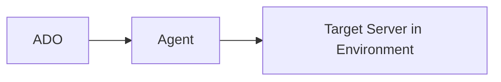

# Markdown
Lightweight markup language for simple text formatting. Easy to read/write with plain text symbols—headers, lists, links, bold, italics. Concise, popular for content creation.


 

## Table Templates

* table 2 columns

|       header 01         |  header 02    |
|-------------------------|---------------|
| Row 01                  |  Row 01       |
| Row 02                  |  Row 02       |

## Alerts

* GitHub-style markdown alert blocks

```markdown
> [!NOTE]
> Highlights information that users should take into account, even when skimming.

> [!TIP]
> Optional information to help a user be more successful.

> [!IMPORTANT]
> Crucial information necessary for users to succeed.

> [!WARNING]
> Critical content demanding immediate user attention due to potential risks.

> [!CAUTION]
> Negative potential consequences of an action.
```

> [!NOTE]  
> Highlights information that users should take into account, even when skimming.

> [!TIP]
> Optional information to help a user be more successful.

> [!IMPORTANT]  
> Crucial information necessary for users to succeed.

> [!WARNING]  
> Critical content demanding immediate user attention due to potential risks.

> [!CAUTION]
> Negative potential consequences of an action.


