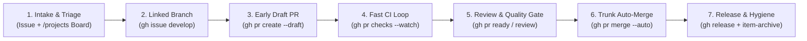

# Software Development Lifecycle (SDLC)

[Kiwiki Home](/../../)

[Back to Main Page](./readme.md)

## Sub-Sections

* [GitHub CLI (`gh`) Full Reference & `/projects` Automation](../devops-tools/git/github-cli.md)
* [Markdown Documentation](./documentation/markdown/readme.md)
* [Software Testing](./testing/readme.md)

---

## Stack-Neutral SDLC Patterns for Stable Engineering Flow

Stable software delivery flow depends on **small batch sizes, explicit Work-in-Progress (WIP) limits, fast automated feedback, and trunk stability**—principles that apply identically regardless of programming language (Go, Python, Java, Rust, TypeScript, C#) or infrastructure stack (Kubernetes, Terraform, Serverless).



### 1. Standardized Triage & `/projects` Governance (`gh project`)

Use a single cross-repository board with consistent schema fields (`Status`, `Priority`, `Size`, `Target Date`) so engineering throughput and bottlenecks are visible without relying on inconsistent per-repo labels.

* Provision a project board from an organization template and configure standard SDLC fields

```bash
ORG="my-org"
PROJECT_NUM=4

# Clone template board with draft items
gh project copy 1 --source-owner "$ORG" --target-owner "$ORG" --title "Q4 Core Platform" --drafts

# Add standard Priority and Size fields
gh project field-create "$PROJECT_NUM" \
  --owner "$ORG" \
  --name "Priority" \
  --data-type "SINGLE_SELECT" \
  --single-select-options "P0-Critical,P1-High,P2-Medium,P3-Low"

gh project field-create "$PROJECT_NUM" \
  --owner "$ORG" \
  --name "Size" \
  --data-type "SINGLE_SELECT" \
  --single-select-options "XS,S,M,L,XL"
```

### 2. Issue-First Traceability & Linked Branching (`gh issue develop`)

Prevent untracked work and orphan branches by requiring every code change to start from a scoped issue linked on the `/projects` board.

* Create an issue, add it to the `/projects` board as `In Progress`, and check out a linked branch

```bash
ORG="my-org"
PROJECT_NUM=4

ISSUE_URL=$(gh issue create \
  --title "feat(api): enforce idempotency keys on write endpoints" \
  --body "Acceptance Criteria:\n- [ ] Reject duplicate keys within TTL\n- [ ] Add integration test" \
  --label "enhancement" \
  --assignee "@me")

gh project item-add "$PROJECT_NUM" --owner "$ORG" --url "$ISSUE_URL"
gh project item-edit "$PROJECT_NUM" --owner "$ORG" --url "$ISSUE_URL" --field "Status" --value "In Progress"
gh project item-edit "$PROJECT_NUM" --owner "$ORG" --url "$ISSUE_URL" --field "Priority" --value "P1-High"

ISSUE_NUM="${ISSUE_URL##*/}"
gh issue develop "$ISSUE_NUM" --checkout --name "feat/${ISSUE_NUM}-idempotency-keys"
```

### 3. Small Batch Sizes & Early Draft Pull Requests (`gh pr create --draft`)

Keep pull requests small (ideally < 300 lines changed, reviewable in < 15 minutes). Open a **Draft PR** on the very first push to validate CI build, lint, and security gates early.

* Push the first atomic commit, open a Draft PR, and register it on the project board

```bash
ORG="my-org"
PROJECT_NUM=4

git push -u origin HEAD
PR_URL=$(gh pr create --draft --base main --fill --assignee "@me")

gh project item-add "$PROJECT_NUM" --owner "$ORG" --url "$PR_URL"
gh project item-edit "$PROJECT_NUM" --owner "$ORG" --url "$PR_URL" --field "Status" --value "In Progress"
```

### 4. Controlling Work-in-Progress (WIP) & Review-First Cadence

By Little's Law ($\text{Lead Time} = \frac{\text{WIP}}{\text{Throughput}}$), starting new work before finishing and reviewing in-flight work increases cycle time and merge conflicts. Engineers should run a review-first check each morning before writing new code.

* Audit PRs awaiting your review, your active PR checks, and your in-progress `/projects` items

```bash
ORG="my-org"
PROJECT_NUM=4

# 1. Unblock teammates first: PRs waiting on your review
gh pr list --search "is:open review-requested:@me -is:draft"

# 2. Check your own open PR status
gh pr status

# 3. Check your active WIP on the project board
gh project item-list "$PROJECT_NUM" \
  --owner "$ORG" \
  --query "assignee:@me -status:Done" \
  --field "Status" \
  --field "Priority"
```

### 5. Trunk Stability via Rebase, Quality Gates & Auto-Merge

Keep `main` deployable at all times. Before requesting review, rebase onto `main`, verify CI checks in the terminal, transition the project item to `In Review`, and enable auto-merge.

* Rebase branch, watch CI checks, mark PR ready, and queue squash auto-merge

```bash
ORG="my-org"
PROJECT_NUM=4

gh pr update-branch --rebase
gh pr checks --watch --fail-fast
gh pr ready

PR_URL=$(gh pr view --json url --jq '.url')
gh project item-edit "$PROJECT_NUM" --owner "$ORG" --url "$PR_URL" --field "Status" --value "In Review"

gh pr merge --squash --delete-branch --auto
```

### 6. Deterministic Releases & Board Hygiene (`gh release`, `gh project item-archive`)

Cut immutable semantic releases with auto-generated release notes and archive completed items so the `/projects` board stays focused on active work.

* Create a verified semantic release and archive `Done` project items

```bash
ORG="my-org"
PROJECT_NUM=4

gh release create v1.4.0 --generate-notes --verify-tag

gh project item-list "$PROJECT_NUM" --owner "$ORG" --query "status:Done" --format json \
  --jq -r '.items[].id' | while read -r item_id; do
    gh project item-archive "$PROJECT_NUM" --owner "$ORG" --id "$item_id"
done
```

[Back to top](#)

[Kiwiki Home](/../../)
